# SMPTeX · The Android Picture Book 📺

[← README](README.md) · [Live math card](GITHUB_MATH_TEST_CARD.md) · [Compatibility ledger](MATH_COMPATIBILITY_LEDGER.md) · [Upstream fix](GITHUB_MOBILE_UPSTREAM_REPORT.md)

> **The GitHub app for Android has apparently adopted an innovative interpretation of Markdown support in which the mathematics is optional.** Here are 22 actual math images, because apparently the app that hosts source code needs pictures.

**Purpose:** this is a static visual reference for environments that do not show live mathematics. Each PNG is rendered from the **exact source mathematics in T00–T21**, not manually retyped. Adjacent expressions separated by presentation spacing have been reflowed into separate lines for legibility.

**Boundary:** PNG fallback is **not a fix for GitHub's proprietary Android app**, and a PNG appearing on screen is **not a passing TeX-render test**. Native Android display of these new PNGs has NOT yet been tested.

## 22 reference images
### T00 · Synchronization · Plain inline math

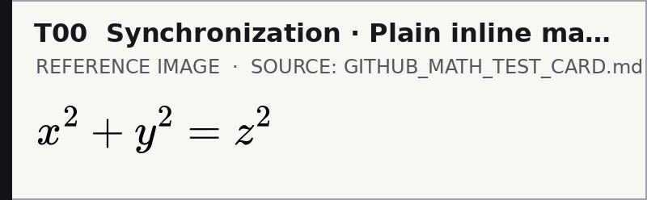

### T01 · Inline protection · GitHub's backtick-dollar form

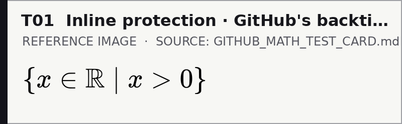

### T02 · Primary display channel · Isolated dollar pairs

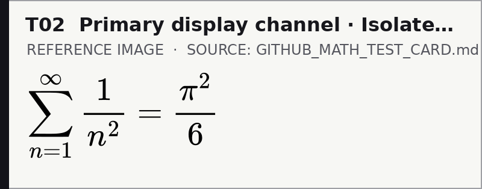

### T03 · Alternative display channel · Math code fence

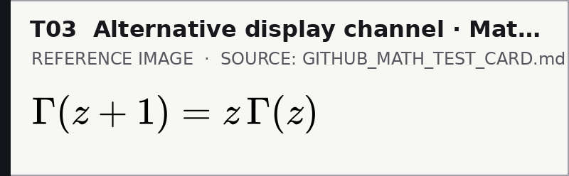

### T04 · Control characters · Greek, indices, adornments

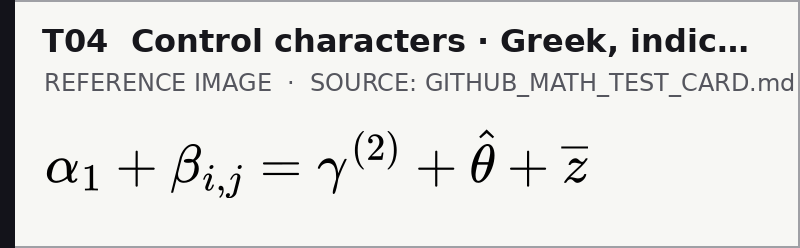

### T05 · Mathematical alphabets · Black-board, calligraphic, upright

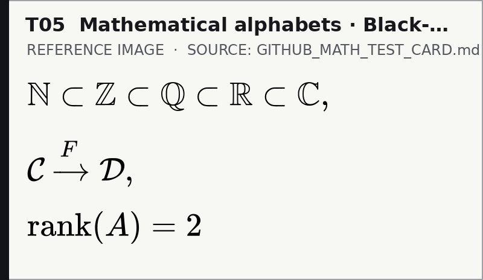

### T06 · Alignment · Multiple equalities

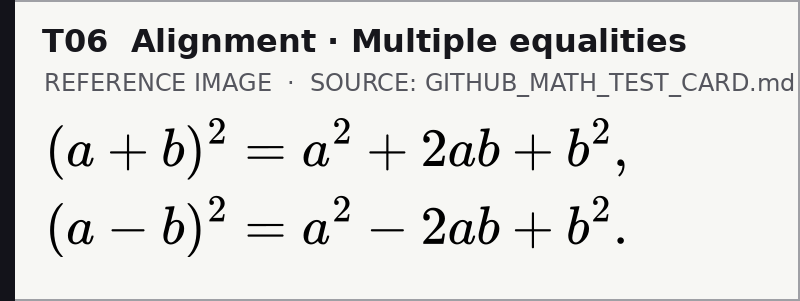

### T07 · Matrix geometry · Brackets and rows

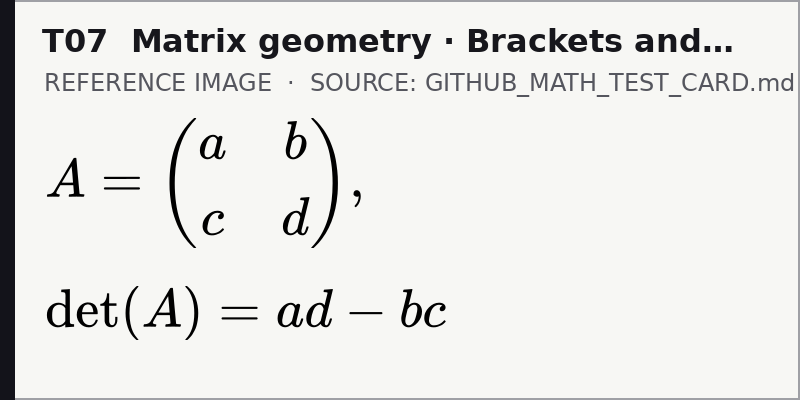

### T08 · Piecewise logic · Cases

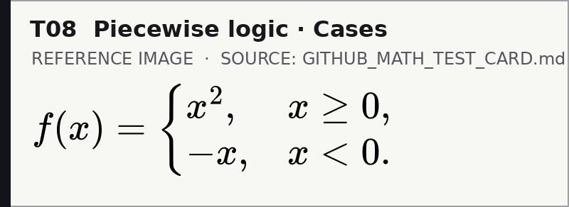

### T09 · Analysis · Limits, integrals, derivatives

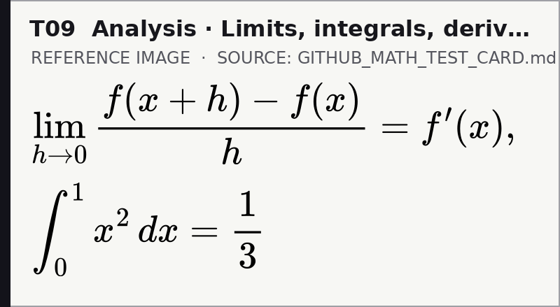

### T10 · Category theory · Composition preservation

### T11 · Physics / operators · Brackets, adjoints, tensor products

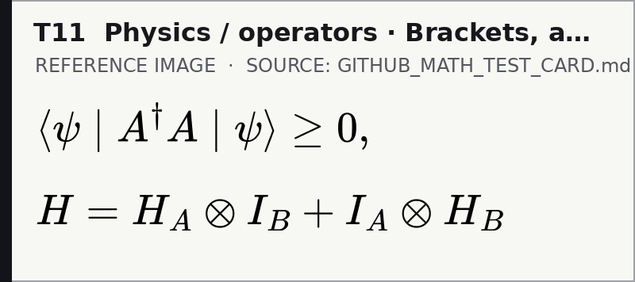

### T12 · Number theory · Products, zeta and primes

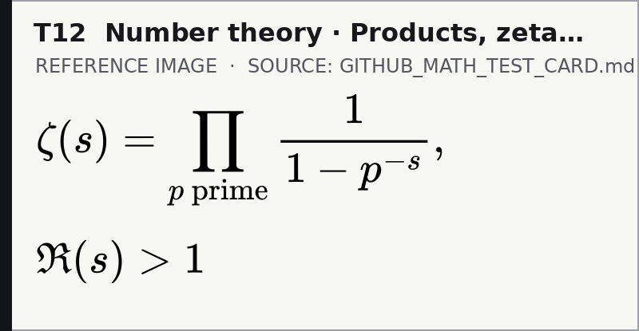

### T13 · Quotient structure · Ring comparison

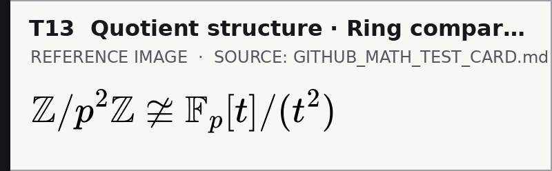

### T14 · Quantifiers, implications, sets

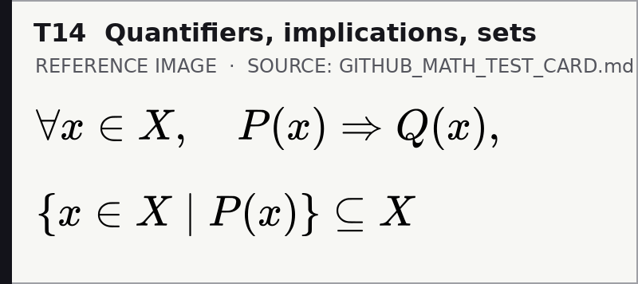

### T15 · Larger fences · Paired delimiters

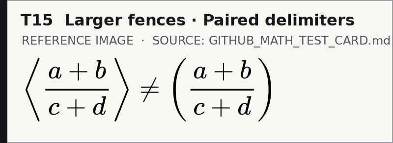

### T16 · Typography · Upright text amid symbols

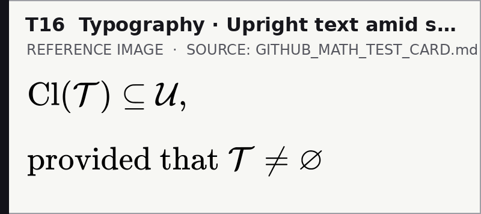

### T17 · Project vocabulary · TLICA diagnostic vector

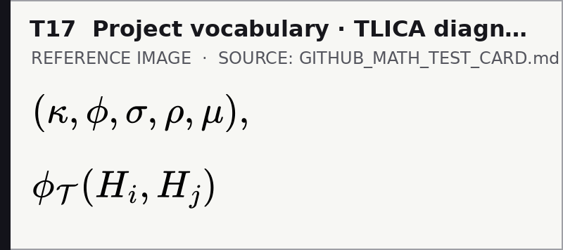

### T18 · Project vocabulary · SUCC and FUCC operators

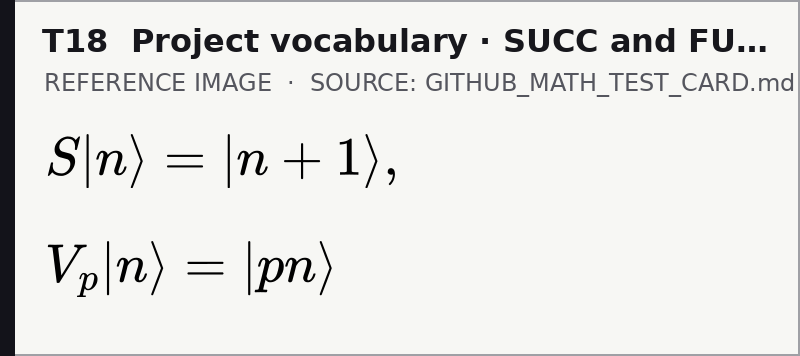

### T19 · Currency interference · Literal dollar next to inline math

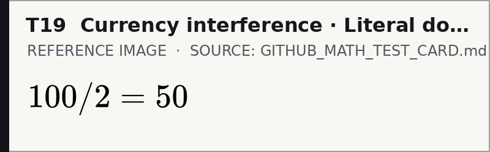

### T20 · High-density signal · Multi-line equation

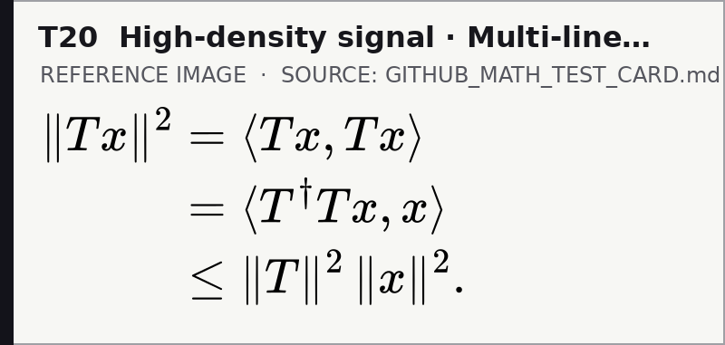

### T21 · GitHub table interference · Avoid bare pipe characters

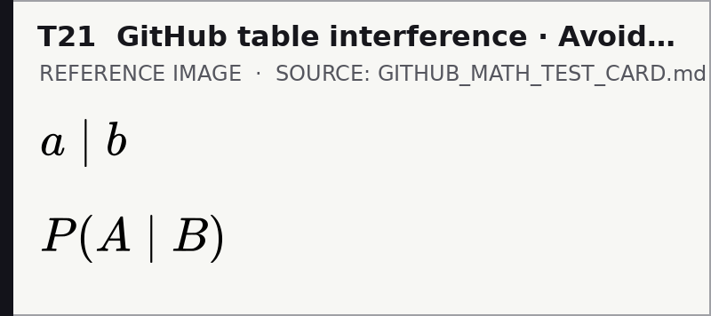

## Validation and rebuilding

Only standard-library Python is needed to verify the source mapping and committed images:

~~~bash
python scripts/mobile_fallback.py
python -m unittest discover -s tests -v
~~~

To regenerate images after changing a live TeX strip (requires Node.js, CairoSVG, Pillow, and MathJax):

~~~bash
npm install --no-save --package-lock=false mathjax-full@3.2.1
python -m pip install 'Pillow==12.3.0' 'CairoSVG==2.8.2'
python scripts/mobile_fallback.py --build
~~~

Generated assets and their SHA-256 checksums are recorded in assets/mobile/manifest.json. Regeneration can change pixel digests across environments; **inspect the images visually before committing**. The builder is deliberately scoped to audited local reference TeX, not arbitrary untrusted network Markdown.

## Remaining live-app test

Open this page using the **GitHub Android app** and inspect individual image cards T00, T05, T10 and T20. Record screenshots at actual device resolution. The real browser-calibrated reference is still the [live math card](GITHUB_MATH_TEST_CARD.md), whose T00–T21 strips were reported passing in both phone and PC web browsers.

**Message to the Android app:** We fixed the part we had source code for. The other part is yours.
