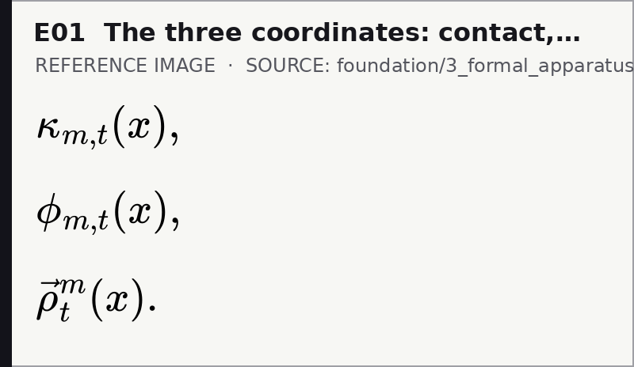
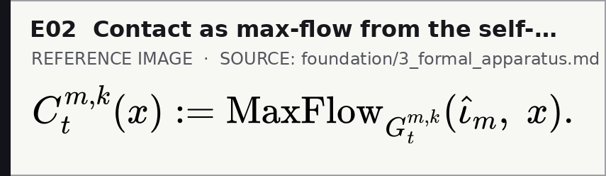
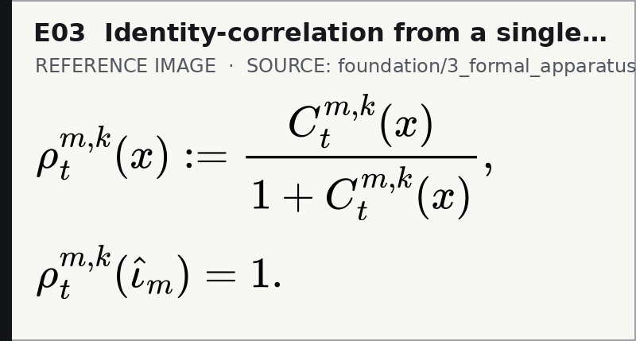
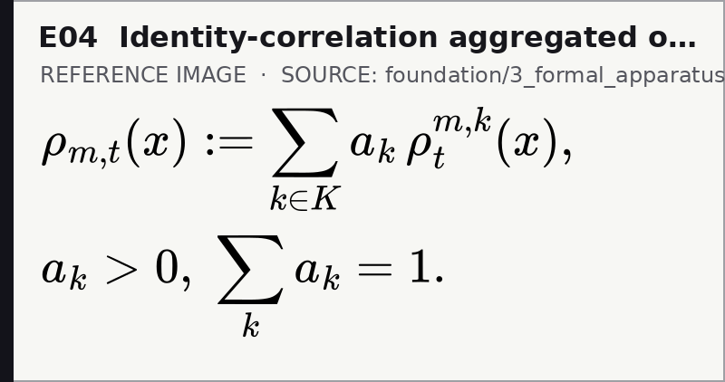
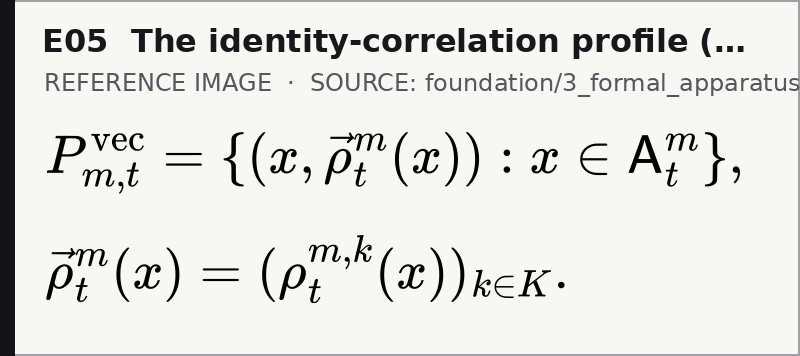
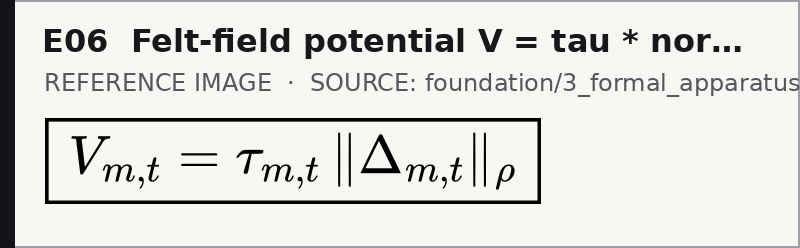
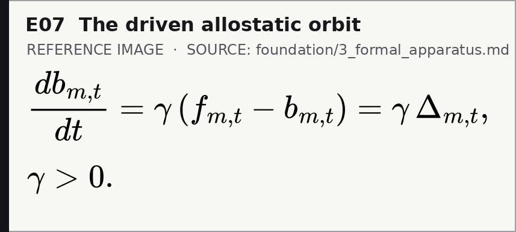
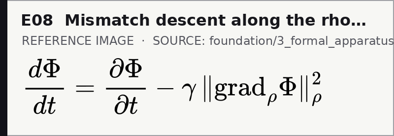
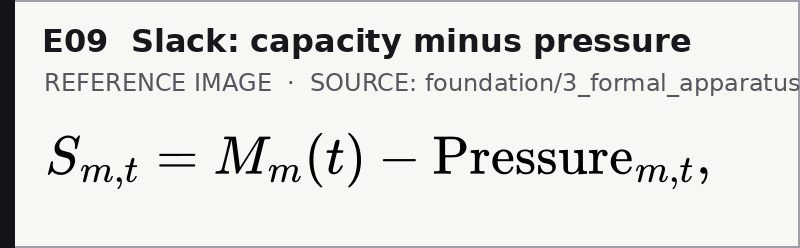
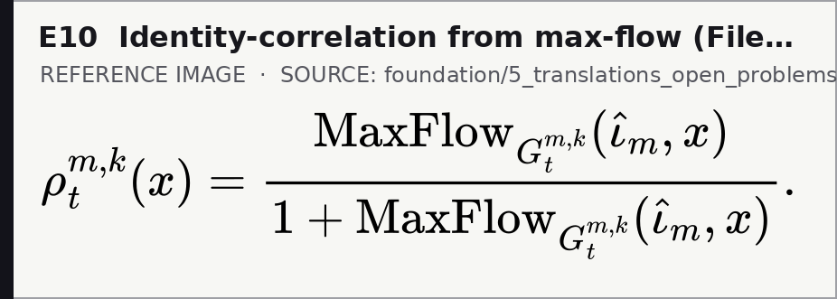

# TLICA core equations — Android-app fallback 📱

[← calibration kit](README.md) · [calibration strips](MOBILE_APP_FALLBACK.md) · [compatibility ledger](MATH_COMPATIBILITY_LEDGER.md)

> **Why this page exists.** GitHub's Android app renders no live MathJax, so on the app the equations below would otherwise appear as raw `$…$` source. Each image is rendered from the **exact TeX in the source file named beneath it** — never retyped — and pinned to a SHA-256 of that source, so it cannot silently drift. On desktop or a mobile **web browser**, read the live theory instead; this is a fallback, not the canon.

> **Boundary.** A PNG appearing on screen is **not** a passing TeX-render test, and these ten equations are a reader's entry map, not the full formal apparatus — that lives in the [foundation](../../foundation/).

## The load-bearing equations

### E01 · The three coordinates: contact, truth-indistinguishability, identity



*Source: [`foundation/3_formal_apparatus.md`](../../foundation/3_formal_apparatus.md).*

### E02 · Contact as max-flow from the self-node



*Source: [`foundation/3_formal_apparatus.md`](../../foundation/3_formal_apparatus.md).*

### E03 · Identity-correlation from a single toolkit



*Source: [`foundation/3_formal_apparatus.md`](../../foundation/3_formal_apparatus.md).*

### E04 · Identity-correlation aggregated over toolkits



*Source: [`foundation/3_formal_apparatus.md`](../../foundation/3_formal_apparatus.md).*

### E05 · The identity-correlation profile (vector-valued rho)



*Source: [`foundation/3_formal_apparatus.md`](../../foundation/3_formal_apparatus.md).*

### E06 · Felt-field potential V = tau * norm of Delta



*Source: [`foundation/3_formal_apparatus.md`](../../foundation/3_formal_apparatus.md).*

### E07 · The driven allostatic orbit



*Source: [`foundation/3_formal_apparatus.md`](../../foundation/3_formal_apparatus.md).*

### E08 · Mismatch descent along the rho-metric gradient



*Source: [`foundation/3_formal_apparatus.md`](../../foundation/3_formal_apparatus.md).*

### E09 · Slack: capacity minus pressure



*Source: [`foundation/3_formal_apparatus.md`](../../foundation/3_formal_apparatus.md).*

### E10 · Identity-correlation from max-flow (File 5 form)



*Source: [`foundation/5_translations_open_problems_conclusion.md`](../../foundation/5_translations_open_problems_conclusion.md).*

## Rebuilding

Verify committed images against their sources (standard library only):

```bash
python3 scripts/mobile_fallback.py --deck tlica
```

Regenerate after a source equation changes (needs Node + mathjax-full, CairoSVG, Pillow):

```bash
make mobile-fallback            # or: python3 scripts/mobile_fallback.py --build --deck tlica
```

The equation list is [`mobile-math.sources.json`](mobile-math.sources.json); each entry names a source file and a unique substring of the display block to project. Add an entry there, never retype an equation here.

