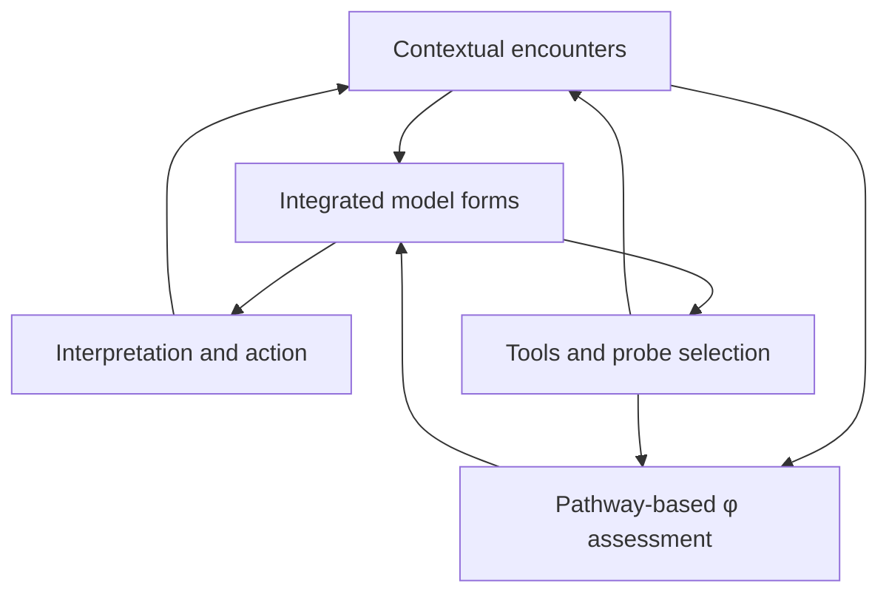

# Trust and the Contact–Integration Loop

## How κ and ρ can jointly develop the capacities through which φ emerges

**Date:** 2026-11-12, America/New_York.

**Tier:** research; author-seeded synthesis and conditional formal models.

**Base examined:** `main` at `61bcb24ed61765d23dd2595b8df4c8beb4fe0a63`; foundation v5.5.2.

**Central human-mechanism claim:** CONJECTURED / UNVERIFIED.

**Foundation impact:** none. Existing coordinates, cogito anchoring, and pathway requirements are preserved.

**Reading purpose:** a durable dossier for future integration, with explicit propositions, counterexamples, probes, and a review path.

## 1. The proposal

**An observer's epistemic assessments develop through a feedback loop between contact with the world and the structure through which that contact is interpreted. Trust participates in how the resulting models guide present behavior and select future encounters.**

Leah's decisive correction is that both sides matter:

- **κ/contact:** encounters expose the observer to context-dependent relationships among signals, objects, changes, and consequences of intervention.
- **ρ-bearing integrated form:** the developed model shapes how those encounters are interpreted, how the observer naturally acts, and which places or questions it is more likely to examine next.
- **φ/truth-indistinguishability:** the observer's developed recognition capacities, constructible verification pathways, and probe record support an assessment relative to that observer's toolkit.

The central relation is developmental and dynamical. It is not the numerical rule `φ = κ × ρ`, nor a claim that strong identity attachment makes a belief true. The proposed generator is the **structured encounter–interpretation–action history**, with contact, integration, and epistemic standing providing different descriptions of its operation.

Trust enters as a scoped relation through which an observer habitually or deliberately allows a model or source to guide interpretation, verification, and action. This can concern another person, an instrument, a learned skill, or an expectation about environmental regularity. Interpersonal trust additionally concerns another agent's commitments and conduct; these uses should be compared without declaring them identical.

The [author seed](AUTHOR_SEED.md) preserves the original three turns, the correction from a rho-centered account to the joint kappa–rho account, and the later osmotic-imprinting and social-inheritance extension.

## 2. What the existing foundation already says

This packet develops an existing structural commitment. It does not discover that the coordinates were causally isolated and then reconnect them.

[File 3 §7.4](../../foundation/3_formal_apparatus.md) explicitly distinguishes formal non-reducibility from dynamic entanglement. Contact can build integration; integration can direct salience; epistemic distinctions can reorganize integration. [File 2 §3](../../foundation/2_access_and_development.md) places verification-tool development within encounter, substrate patterning, accumulated lived-I structure, and focus. [File 3 §§8.2–8.7](../../foundation/3_formal_apparatus.md) describes the attention and imprinting dependencies.

The open problem is more specific: **give those dependencies enough structure to predict when a contact–integration history develops useful discrimination, when it merely reinforces a model, and how trust changes the subsequent history.**

The current foundation declares several dependencies while leaving their empirical maps and rates unspecified. Writing a new symbol around them does not close that gap. The intended contribution is a testable research contract and a set of separating cases.

## 3. Reality supplies encounters; persistence is learned through relations

The author's object-persistence example is a particularly useful testbed. Suppose a signal appears when an object is in a certain location. An observer encounters it repeatedly, changes position, watches an occlusion, acts on the object, or returns after an interval. The relevant information is carried by the relation among the signal, context, action, and later consequence.

Contact can support learning that something persists across changes in presentation. It can also expose a learned persistence model as inadequate. Neither outcome follows from contact intensity or encounter count alone.

Three distinctions are required:

1. **Actual contact versus attributed object.** A physical signal can reach the observer while the observer is wrong about which object or process generated it. The current content-level κ definition uses a source map; access to a signal is not automatic access to its correct source attribution.
2. **A contact value versus a contact history.** An instantaneous κ value does not encode every past context, temporal correlation, intervention, sensor condition, or remembered result. A generative account must declare which of those records it retains.
3. **Repeated evidence versus repeated presentation.** Re-presenting an identical deterministic observation adds no new separating condition. Fresh noisy observations can add evidence under an appropriate sampling/noise model. Repetition is therefore neither automatically verification nor automatically useless.

The simplest hostile rival is a replay: a persistent object and a repeated recording may produce the same observations from one viewing condition. Moving, intervening, or changing context can make them diverge. This is a finite source-discrimination problem, not a proof that all persistence beliefs are illusory.

The key question is: **which contextual changes make the preferred persistence model and its live rivals predict different outcomes?**

## 4. Integrated interpretation changes both behavior and future evidence

An integrated model has an operating role. It helps determine what an encounter means, which response feels ordinary, what the observer expects, and which further observation seems worthwhile. Some responses are habitual or substrate-mediated; some involve deliberate inquiry. The mechanism must accommodate both.

An observer that already interprets a recurring signal as a stable object might look for continuity under occlusion. Another might repeatedly inspect the same confirming view. A third might treat deviations as noise. These policies produce different future encounter records even when their initial exposure budgets are matched.

That is the selection feedback in the author's correction:

> The model of the encountered signal helps organize the next action and the next opportunity to encounter evidence about that model.

The following is a dependency diagram, not a measured biological circuit:

The canonical world–substrate–self cycle remains in force: world contact is mediated by substrate; internal reconstruction and action realization are different operations; the later world is not obtained by inverting observation. This diagram isolates one research mechanism inside that cycle. It does not identify the internal content with its external source.

## 5. Full forms carry more information than coordinate values

The foundation's identity-correlation construction starts from historical integration graphs. Its primary rho object is a vector over integration modes, with optional scalar projection. Those readings compress structure. Equal rho values need not imply equal toolkits, probe outcomes, source dependencies, or policies.

The author's phrase **rho-associated forms** should therefore be taken seriously. The proposed explanation concerns structured realization, rather than an identity-strength number.

This still leaves a sufficiency question. An integration graph containing only weighted attachment edges may fail to retain epistemically necessary information. Enriching it with every answer by fiat would make a derivation vacuous. The research task is to specify a representation that preserves the required distinctions economically, then test it on cases not used to design it.

The [formalism](FORMALISM_AND_PROBES.md) separates two obligations:

- **Current assessment:** histories mapped to the same proposed state must agree on the relevant assessment and its definedness.
- **Future dynamics:** given the same declared action/input conditions, histories mapped to the same state must support consistent next-state predictions. A representation can satisfy the first obligation and fail the second.

Both obligations matter if the goal is a generative architecture rather than retrospective labeling.

## 6. Trust as an operating relation in the loop

A candidate working definition is:

> **Trust is scoped reliance through which an observer lets an integrated model or source guide interpretation, inquiry, or action before independently reconstructing every relevant warrant for that particular use.**

This can be habitual, felt, or deliberative. The definition does not require obliviousness, lack of monitoring, universal confidence, or surrender of agency. It is a research definition broad enough for the author's generalization; interpersonal commitment and vulnerability remain additional structure to be represented.

Trust has at least three candidate operating sites:

| Site | What reliance changes | Example question |
| --- | --- | --- |
| Interpretive uptake | How a signal or testimony enters the current model | How readily does this source's explanation organize the encounter? |
| Inquiry and learning | Which observations, tools, or teachers shape future assessments | Which checks will I run, and which methods will I learn? |
| Action and exposure | Which consequences the observer accepts on that model's guidance | What will I do before checking the entire chain myself? |

The table is a decomposition to test, not an established exhaustive taxonomy. The same source may receive different reliance in different domains and at different stakes. Perceived competence, commitments, practical alternatives, and the capacity to revise reliance must remain explicit where relevant.

The repo already contains a local trust gate in [Out of the Cave](../../applications/out_of_the_cave_v0_1_2.md): another person can extend contact and tools, and an affective relationship can sustain learning through uncertainty. [Agency Architecture](../../docs/app-agency-architecture.md) distinguishes felt ownership from source and option adequacy. [Affective Epistemic Compression](../../docs/affective-epistemic-compression.md) distinguishes commitment changes from earned epistemic updates. This dossier connects those existing pieces to the author's contact–integration loop.

## 7. The derivative metaphor and the power connection

The phrase **trust as the derivative form of truth** is preserved as an author metaphor. A precise proposed interpretation is the forward operation of an assessment: how present epistemic standing, or presumed standing, becomes a disposition to rely during the next encounter.

No derivative of a truth value has been defined. A local derivative of an observer's state update with respect to a source input could quantify influence after the state, input, intervention, and differentiability assumptions are specified. Such a derivative measures influence, not trust by definition. Coercion, dependence, and ordinary sensory effects can also produce influence.

Trust can nevertheless configure important routes of influence. One route changes a particular judgment. Another changes how the observer judges: the trusted source shapes concepts, tests, standards, or future source selection. The second route can alter the machinery that evaluates later influence.

This explains the proposed phenomenological feature without making it a universal law. A source can be incorporated into ordinary functioning so that acting on its output feels coherent and self-owned. Helpful teaching and exploitative control can both use an accepted input channel. Their distinction requires source, consequence, correction, and agency evidence; coherence alone does not settle it.

The normative and descriptive layers remain separate. Trust does not create a blanket entitlement to control another observer, and an observer's actual reliance does not by itself establish consent, legitimacy, or good sourcing. These distinctions preserve existing agency commitments rather than adding a moral score to φ.

## 8. What “emergent φ” commits us to

For the cogito, the foundation fixes φ at `1 − δ` and core rho at `1`. For acquired contents with constructible verification pathways, the existing form is `φ = 1 − nδ − ε`. The offset δ is structural, not a measured error probability; ε is the empirical probe term. Intrinsic mathematics, logic, and reason remain outside the φ-domain. [Foundation reconciliation](SOURCES_AND_RECONCILIATION.md)

The present proposal concerns how an observer develops the capacity to construct and use those pathways. It does not grant an always-defined hidden φ to every effective disposition. A tacit skill can be useful before its source is articulate; performance can also be probed without a verbal account. The relevant boundary is constructibility of a verification pathway, not eloquence or momentary conscious reflection.

Maintain separate records for a constructible probe, its effective availability, and actual execution. Likewise distinguish the foundation's source map from confidence in an inferred source map, and its probe-weighting measure from application-level availability diagnostics. [TLICA–EPIC extension gate](../tlica_epic_path_geometry_2026-10-03/FOUNDATION_EXTENSION_GATE.md)

Coupling has no universal monotonic direction. Learning a better test can lower an old claim's φ while strengthening reliance on the teacher. Familiarity can grow while source adequacy remains unresolved. A successful discriminating observation can change an assessment before integration changes appreciably. These are required cases for the proposed mechanism.

### 8.1 Osmotic development and inherited environments

The author's appended proposal identifies osmotic imprinting as a major mechanism within this loop. The foundation already makes contact enter imprinting updates (§8.4), describes ambient pattern formation and proto-tool development (§8.7), and explicitly treats contact-driven osmotic imprinting as writing the slow structure read as both integration and world interpretation (§8.11, **Posit G**). The [source map](SOURCES_AND_RECONCILIATION.md) records the exact commitments and their limits.

The same proposal extends the loop across people and generations: observers modify the world, and later observers develop inside those modified environments. Shared units, artifacts, procedures, and institutions can reduce the work required to acquire and transport a model. Trust can carry their use before a recipient reconstructs every dependency. This connects directly to the existing [Recursive Epistemic Ratchet](../../docs/recursive-epistemic-ratchet.md).

The [imprinting and social-scaffolding addendum](IMPRINTING_AND_SOCIAL_SCAFFOLDING.md) preserves the author's infinite-resource ideal and gives a restricted identification result with explicit assumptions. It also proposes a typed meaning for learning and transport commuting. Faithful transport can carry an accurate model or an inherited error; thermodynamic openness alone supplies neither identifiability nor optimal learning. The development question is how inherited structure lowers acquisition costs while retaining access to correction.

## 9. What would count as progress

The first target is a model that predicts the effects of changing encounter access and interpretation/selection structure, then survives counterexamples involving replay, copied sources, misleading context, and a changed environment.

The finite [witness](finite_witness.py) and [formalism/probe program](FORMALISM_AND_PROBES.md) support only their declared mathematical scope. They do not measure people, prove that TLICA is a correct theory of cognition, or establish trust as a fundamental primitive. The [claim ledger](CLAIM_LEDGER.md) and [validation record](VALIDATION.md) record what was derived, executed, or remains unverified.

A later empirical program should compare the candidate against simpler explanations, including ordinary active information acquisition and existing integration/focus/tool dynamics. Better explanation requires improved held-out prediction or a necessary representational distinction, not a new label for an old process. Primary-source adjacencies and their limits are recorded in [sources and reconciliation](SOURCES_AND_RECONCILIATION.md).

Foundation promotion should follow the archive's existing gate: recurrence across distinct applications, removal of the candidate to test necessity, a simpler rival, a fresh holdout, counterexample search, provenance review, and reconciliation with current commitments. The immediate next steps are in [the integration handoff](INTEGRATION_HANDOFF.md).

## 10. Dossier map

- [Author seed](AUTHOR_SEED.md): the originating trust proposal and both corrections.
- [Imprinting and social scaffolding](IMPRINTING_AND_SOCIAL_SCAFFOLDING.md): the appended osmotic mechanism, ideal-observer limit, and good/bad model transport through inherited environments.
- [Formalism and probes](FORMALISM_AND_PROBES.md): typed mechanism, conditional results, rivals, and discriminating tests.
- [Finite witness](finite_witness.py): reproducible exact controls with machine-readable output.
- [Witness results](WITNESS_RESULTS.json): captured output from the declared run.
- [Claim ledger](CLAIM_LEDGER.md): evidence boundaries and falsifiers.
- [Sources and reconciliation](SOURCES_AND_RECONCILIATION.md): existing commitments, primary literature, and notation audit.
- [Integration handoff](INTEGRATION_HANDOFF.md): concrete work needed before promotion.
- [Validation record](VALIDATION.md): baseline, executed gates, provenance, and rendering status.

**Working thesis:** contact supplies contextual constraints; integrated forms organize their interpretation and the next encounter; verification capacity develops within that interaction; trust helps carry the resulting models into further inquiry and action.
